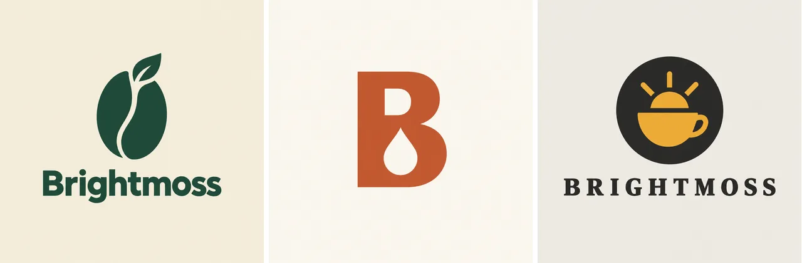
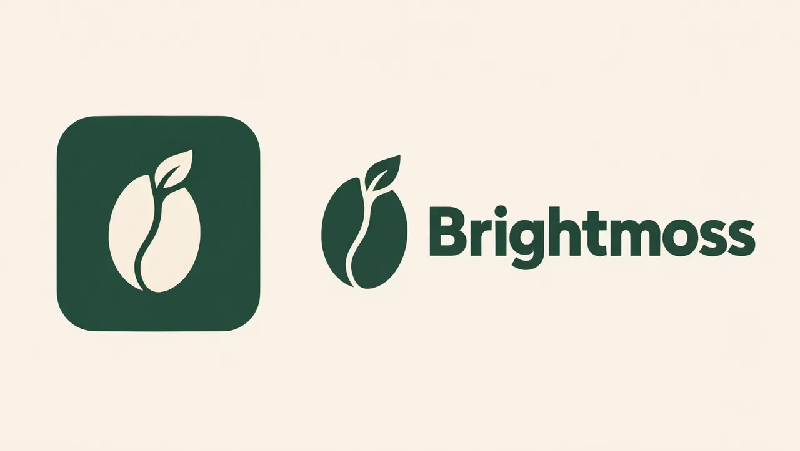

# AI Logo Maker Skill

[English](./README.md) | [简体中文](./README.zh-CN.md) | 日本語

> 👉 こちらもどうぞ [AI Poster Maker Skill](https://github.com/beatra-ai/ai-poster-maker-skill)

ブランド名、業種、または参考画像から、ロゴ案と、どのサイズでも使えるブランドマークを作成。Claude Code、Cursor、Codex、Windsurf、Cline、OpenClaw のどれからでもそのまま使えます。

> [!IMPORTANT]
> 生成には [Beatra](https://beatra.ai?utm_source=github&utm_medium=flagship&utm_campaign=ai-logo-maker-skill) アカウントが必要で、クレジットを消費します。スキル自体のインストールは無料です。

| 項目 | 内容 |
| --- | --- |
| **できること** | ブランド名、業種、または参考画像から、プロ品質の AI ロゴ、ブランドマーク、アプリアイコンを作成。多バリアント探索、正確なブランドカラー、スケーラブルな構図に対応。 |
| **モデル** | Qwen Image 3.0、MiniMax H3 Image、Qwen Image 2.0 Fast、Qwen Image 3.0 Pro、GPT Image 2.5 Flare、GPT Image 2.5 Sunburst、GPT Image 2、Wan Image 2.7 Fast、Qwen Image 2.0 Pro、Wan Image 2.7 Pro、Wan 3.0 Video、Wan 2.7、MiniMax H3、Seedance 2.0 Mini、HappyHorse 1.1、Seedance 2.0 Fast、Seedance 2.0、Wan 3.0 Video Prime、Seedance 2.5 |
| **動作要件** | Python 3.10 以上と、`SKILL.md` を読み込めるエージェント |
| **費用** | インストールは無料。生成のたびに Beatra アカウントのクレジットを消費しますが、課金されるのは、その生成を明示的に依頼したとき、または確認カードを承認したときだけです。 |
| **対応エージェント** | Claude Code、Cursor、Codex、Windsurf、Cline、OpenClaw |

<p align="center"></p>

*架空のスペシャルティコーヒー焙煎所 Brightmoss のロゴ 3 案：豆と葉を組み合わせたマーク、コーヒーの雫を抜いた B のレターマーク、カップの上に太陽を置いたエンブレム。Beatra AI で生成。*

| Skill | Entry point | Version |
| --- | --- | --- |
| [`ai-logo-maker`](skills/ai-logo-maker) | [SKILL.md](skills/ai-logo-maker/SKILL.md) | 0.3.0 |

このリポジトリは [beatra-ai/beatra-skills](https://github.com/beatra-ai/beatra-skills/tree/main/skills/ai-logo-maker) から自動的に公開されています。問題の報告はそちらへお願いします。

## インストール

[`skills`](https://skills.sh) CLI を使う場合：

```bash
npx skills add beatra-ai/ai-logo-maker-skill
```

Claude Code プラグインとして：

```bash
claude plugin marketplace add beatra-ai/ai-logo-maker-skill
claude plugin install ai-logo-maker@ai-logo-maker-skill
```

Codex プラグインとして：

```bash
codex plugin marketplace add beatra-ai/ai-logo-maker-skill
codex plugin add ai-logo-maker@ai-logo-maker-skill
```

GitHub Copilot CLI プラグインとして：

```bash
copilot plugin marketplace add beatra-ai/ai-logo-maker-skill
copilot plugin install ai-logo-maker@ai-logo-maker-skill
```

Gemini CLI 拡張機能として：

```bash
gemini extensions install https://github.com/beatra-ai/ai-logo-maker-skill
```

Antigravity CLI プラグインとして：

```bash
agy plugin install https://github.com/beatra-ai/ai-logo-maker-skill
```

GitHub CLI を使う場合：

```bash
gh skill install beatra-ai/ai-logo-maker-skill ai-logo-maker
```

または、このリポジトリをクローンして `skills/ai-logo-maker` を次の場所にコピーします：Claude Code は `~/.claude/skills/`、Cursor は `~/.cursor/skills/`、Codex は `~/.agents/skills/`、Windsurf は `~/.codeium/windsurf/skills/`、Cline は `~/.cline/skills/`、OpenClaw は `~/.openclaw/skills/`。

または、次の文をエージェントに貼り付けてください：

```text
https://github.com/beatra-ai/ai-logo-maker-skill から ai-logo-maker スキル（フォルダ skills/ai-logo-maker）をインストールし、その SKILL.md に従って私の Beatra アカウントに接続してください。
```

クリーン環境で動作確認済み：Antigravity CLI (2026-11-09)。

## 作例

<p align="center"></p>

*採用した Brightmoss の豆と葉のマークを、アプリアイコンと横組みのワードマークに仕上げたもの。Beatra AI で生成。*

エージェントへの依頼例：

```text
決定済みの Brightmoss の豆と葉のロゴを、深いフォレストグリーンの角丸四角のアプリアイコンと横組みのワードマークにして、同じ温かみのあるクリーム色の背景にまとめて。
```

プロンプト：

```text
Refine this accepted Brightmoss logo into a two-part brand presentation on one flat warm cream background (#F4EEE2). Left: an app icon, a solid rounded square in deep forest green (#1F4D3A) with the same coffee-bean-and-leaf symbol from the image centered inside in cream, generous padding, no text in the icon. Right: a horizontal lockup, the same green bean-and-leaf symbol placed to the left of the exact word "Brightmoss" in the same bold humanist sans-serif lettering, forest green, vertically centered with the symbol. Keep the symbol shape and the wordmark letterforms identical to the source. Flat vector, maximum two colors, no gradients, no shadows, no mockup, no tagline, no other text.
```

## 入力と出力

| | 種類 | 形式 | 仕様 |
| --- | --- | --- | --- |
| **入力** | テキスト：ブランド名、業種、カラーの希望 | — | — |
| **入力** | 画像：スケッチ、ムードボード、既存のブランド素材（任意） | JPG、PNG、WEBP | 1 リクエストあたり最大 4 枚 |
| **出力** | 画像：正方形マスターのロゴ案 | PNG | 1 リクエストあたり最大 4 枚／2K／アスペクト比 1:1 |
| **出力** | 動画：ロゴのアニメーション動画（任意） | MP4 | — |

## 技術仕様と出力上限

2026-11-14 時点。最新の一覧：https://docs.beatra.ai/ja/docs/models

- **アップロード** — 1 ファイルあたり最大 100 MB。下記の各モデルの入力制限も適用されます
- **テキストから画像** — 10 モデル（Qwen Image 3.0、MiniMax H3 Image、Qwen Image 2.0 Fast、Qwen Image 3.0 Pro、GPT Image 2.5 Flare、GPT Image 2.5 Sunburst、GPT Image 2、Wan Image 2.7 Fast、Qwen Image 2.0 Pro、Wan Image 2.7 Pro）／PNG／1 リクエストあたり最大 4 枚／キャンバス最大 16.8 MP
  - 16.8 MP（4K ティア）：MiniMax H3 Image、Wan Image 2.7 Pro（1 リクエストあたり最大 4 枚）／GPT Image 2.5 Flare、GPT Image 2.5 Sunburst、GPT Image 2（1 リクエストにつき 1 枚）
- **画像から画像** — 10 モデル（Qwen Image 2.0 Fast、MiniMax H3 Image、Qwen Image 3.0、Qwen Image 3.0 Pro、Wan Image 2.7 Fast、Qwen Image 2.0 Pro、Wan Image 2.7 Pro、GPT Image 2.5 Flare、GPT Image 2.5 Sunburst、GPT Image 2）／PNG／1 リクエストあたり最大 4 枚／キャンバス最大 16.8 MP
  - 16.8 MP（4K ティア）：MiniMax H3 Image（1 リクエストあたり最大 4 枚）／GPT Image 2.5 Flare、GPT Image 2.5 Sunburst、GPT Image 2（1 リクエストにつき 1 枚）
  - 入力画像：1 リクエストあたり最大 4 枚、各 10〜20 MB／BMP、GIF、JPEG、PNG、TIFF、WEBP
- **画像編集** — 7 モデル（Qwen Image 2.0 Fast、MiniMax H3 Image、Qwen Image 3.0、Qwen Image 3.0 Pro、Wan Image 2.7 Fast、Qwen Image 2.0 Pro、Wan Image 2.7 Pro）／PNG／1 リクエストあたり最大 4 枚／キャンバス最大 16.8 MP
  - 16.8 MP（4K ティア）：MiniMax H3 Image（1 リクエストあたり最大 4 枚）
  - 入力画像：1 リクエストあたり最大 4 枚、各 10〜20 MB／BMP、GIF、JPEG、PNG、TIFF、WEBP
- **画像から動画** — 9 モデル（Wan 3.0 Video、Wan 2.7、MiniMax H3、Seedance 2.0 Mini、HappyHorse 1.1、Seedance 2.0 Fast、Seedance 2.0、Wan 3.0 Video Prime、Seedance 2.5）／480p〜4K／2〜30 秒／アスペクト比 16:9、1:1、21:9、3:4、4:3、9:16／MOV、MP4
  - 4K：Seedance 2.0、最長 15 秒
  - 30 秒：Wan 3.0 Video、Wan 3.0 Video Prime、Seedance 2.5、最高 1080p
  - ネイティブ音声：Wan 2.7、MiniMax H3

## 得られるもの

- **決める前に探索する** — 一つのブランドブリーフから複数のロゴコンセプトを生成し、方向を並べて比較、最も強いものを洗練。プロのロゴデザインは選択肢から始まります。
- **あらゆるサイズのために設計** — すべてのコンセプトは favicon の明瞭さ、アプリアイコンの精度、ソーシャルアバターのインパクトのために構成。16ピクセルから看板まで認識できる強いシルエットと限定的なパレット。
- **正確なブランドカラー** — hex 値と加重パレットで正確なブランドカラーを固定し、ロゴにランダムではなくあなたのアイデンティティを反映。

## 活用シーン

- **新規ビジネスとスタートアップのロゴ** — 社名と業種からプロ品質のブランドアイデンティティへ。方向を決める前に複数のコンセプトを比較。
- **アプリアイコンとプロダクトマーク** — アプリストア、favicon、ダッシュボード、製品リリースに対応する角型アイコン。セーフエリアの余白を内蔵。
- **既存素材からのブランドリフレッシュ** — スケッチ、ムードボード、既存のロゴを洗練されたモダンなマークに変換しながら、元の方向を保持。
- **ソーシャルメディアとコンテンツのブランディング** — プロフィールアバター、透かし、プラットフォームやコンテンツ形式をまたぐ一貫した視覚アイデンティティを構築。

## よくある質問

### どんなロゴスタイルが作れますか？

ワードマーク、レターマーク、ピクチャリアルマーク、抽象マーク、モノグラム、エンブレム、コンビネーションマーク。ブランド名、業種、希望する雰囲気を共有すると、文脈に最適なスタイルをおすすめします。

### 小さな favicon でも鮮明ですか？

すべての案を、強いシルエット、高いコントラスト、最小限のディテールで小さなサイズ向けに作るので、favicon にも使えます。

### 既存のブランドカラーに合わせられますか？

はい。hex のカラー値を伝えると、その色をロゴの配色に使います。

### 既にあるロゴを改良できますか？

はい。既存のロゴやスケッチをアップロードして変えたい点を伝えると、これまでの方向性の中で、その部分を調整します。

## 更新とセキュリティ

2026 年 10 月のリリース以降、このスキルに自動更新機能はありません。インストールしたファイルだけを実行し、
自動的に置き換えることはありません。更新はインストールに使ったツール（`npx skills update ai-logo-maker` または
`gh skill update ai-logo-maker`）で行ってください。詳細はスキル内の `references/updates-and-security.md` を参照してください。

## ライセンス

このリポジトリのスキルファイル（`SKILL.md`、リファレンス、スクリプト）とこの README は [MIT-0](LICENSE) で提供しています。商用を含め、自由に使用・改変・再配布でき、クレジット表記は不要です。

生成は Beatra のクラウドサービスで行われ、[Beatra 利用規約](https://beatra.ai/terms?utm_source=github&utm_medium=flagship&utm_campaign=ai-logo-maker-skill)が適用されます。

## リンク

- スキルページ — https://beatra.ai/skills/ai-logo-maker?utm_source=github&utm_medium=flagship&utm_campaign=ai-logo-maker-skill
- ウェブサイト — https://beatra.ai?utm_source=github&utm_medium=flagship&utm_campaign=ai-logo-maker-skill
- ドキュメント — https://docs.beatra.ai?utm_source=github&utm_medium=flagship&utm_campaign=ai-logo-maker-skill
- コンソール — https://console.beatra.ai
- AI エージェント向け — https://beatra.ai/llms.txt （インデックス）· https://beatra.ai/llms-full.txt （全スキルを 1 ファイルに）
